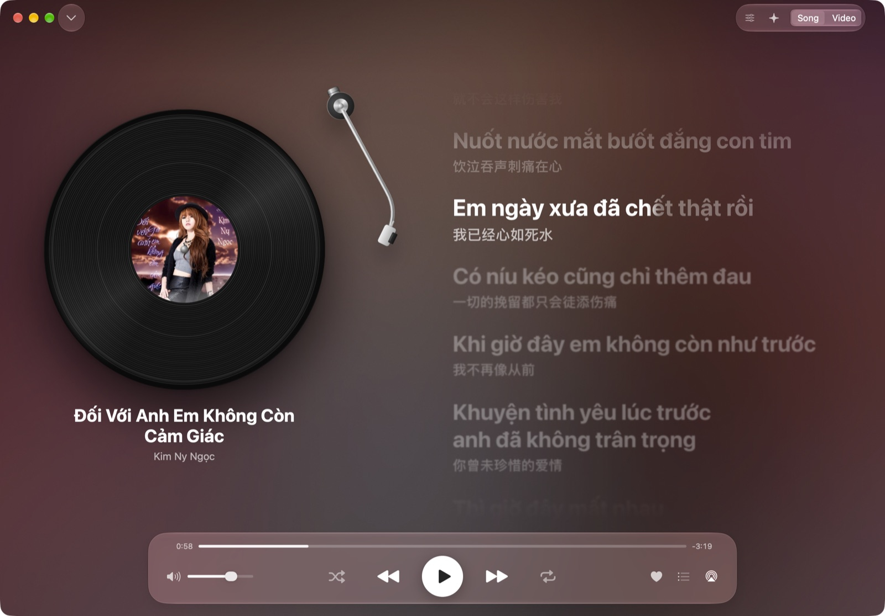
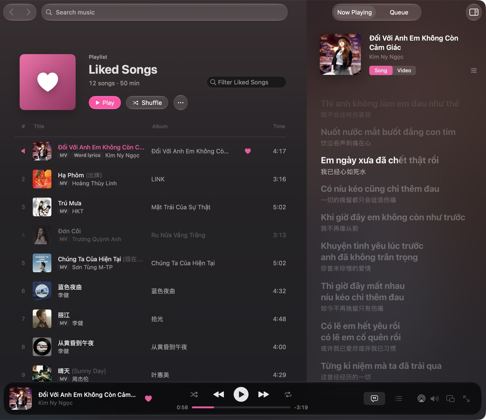
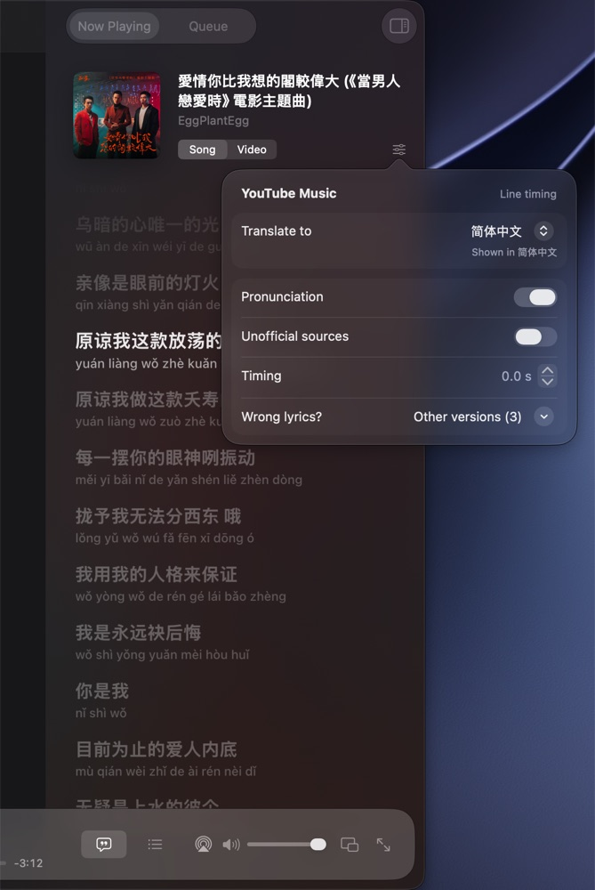

# QTube Music

A native macOS app for YouTube Music, built around the song that's playing: a full-screen Stage, word-synced
lyrics with translation, and Song ⇄ Video at the same moment. It's music only. No Shorts, no podcasts, no
comments, no feeds.

QTube Music is an unofficial client. It isn't made, endorsed or supported by Google or YouTube. You need a
YouTube Music account to see your library. You can browse and play without one, with ads, the same as on the web.



## What it does

- **A real Mac app.** SwiftUI and AppKit, with system controls, menus, shortcuts, Liquid Glass on macOS 26, light
  and dark modes, and English and Simplified Chinese.
- **The Stage.** A full-screen now-playing view with three layouts and five backgrounds: blurred cover, cover,
  vinyl, the music video, and an audio-reactive visualizer.
- **Lyrics that keep up.** Word-by-word karaoke where the source has it. You can scroll back and jump to the
  current line, and set the timing offset. Sources are YouTube Music, LRCLIB and the AMLL TTML DB; NetEase, Kugou
  and QQ Music are opt-in.
- **Translation on your Mac.** The Translation framework, or Apple Intelligence on macOS 26. Chinese lyrics show in
  Simplified or Traditional characters, whichever you pick.
- **Song ⇄ Video.** Switch between the song and its music video without losing your place. Picture in Picture
  works too.
- **Your library.** Home, Explore, Liked songs, playlists and history, in sortable, filterable tables, plus a
  docked Now Playing and Queue panel.
- **The rest of the Mac.** Media keys, Control Center, AirPlay, a mini player, a menu bar player, desktop lyrics,
  Shortcuts and AppleScript.
- **Song colours.** The app takes its accent colour from the cover art. You can switch back to the system accent
  in Settings.



## Install

You need **macOS 15 Sequoia or later**, on Apple silicon or Intel (the app is universal; it's tested on Apple
silicon).

1. Download `QTube-Music-<version>.dmg` from [Releases](https://github.com/RoderickQiu/qtube-music/releases).
2. Open it and drag **QTube Music** to **Applications**.
3. The app isn't notarized yet: I don't have an Apple Developer ID. The first time you open it, macOS says it
   can't check it. Click **Done**, go to **System Settings › Privacy & Security**, scroll down and click
   **Open Anyway**. Or, in Terminal:

   ```sh
   xattr -dr com.apple.quarantine "/Applications/QTube Music.app"
   ```

There are no automatic updates yet. To update, download the new version and replace the app. After an update,
macOS may ask once whether QTube Music can use its Keychain item. Click **Always Allow** so you stay signed in.

## Sign-in and privacy

- **Signing in** happens in a Google sign-in window inside the app. QTube Music keeps your YouTube Music session in
  your **Keychain**. It never writes your password or cookies anywhere else.
- **What goes where.** Browsing and playback talk to YouTube Music, as the web player does, so your plays show up in
  your YouTube Music history. Searches are always sent signed out, so they don't land in your search history.
  Lyrics come from LRCLIB, the AMLL TTML DB on GitHub, YouTube Music, and NetEase, Kugou and QQ Music only if you
  turn on Unofficial sources. Last.fm scrobbling and Discord status are off until you turn them on with your own
  keys.
- **Read-only.** The app doesn't change anything in your YouTube Music account (likes, playlists). Those changes
  stay in the app for now.
- **No analytics.** No tracking, no telemetry, no crash reporting service. Translation runs on your Mac.



## The native engine (experimental)

By default every account plays through YouTube's own web player, inside the app. With **YouTube Music Premium**
you can turn on **Settings › Playback › Native engine (Experimental)**. It plays the audio with Apple's audio
engine, which gives you gapless playback, crossfade and a 10-band equalizer.

Please read this first:

- It fetches the audio streams directly. That isn't how YouTube's Terms of Service want their service used. You
  use it at your own risk.
- It depends on how YouTube serves streams today, and YouTube changes that often. When something breaks, the app
  quietly falls back to the web player until a fix ships.
- Plays through the native engine don't appear in your YouTube Music history.
- Music videos always play through the web player.

## Build from source

You need Xcode 27 (Swift 6.4). The app it builds runs on macOS 15 or later.

```sh
git clone https://github.com/RoderickQiu/qtube-music.git
cd qtube-music
QT_CONFIG=release Scripts/build-app.sh      # → .build/apps/QTube Music.app
swift test --disable-xctest
```

Always run the bundled app that `build-app.sh` makes, not `swift run`. The bundle carries the resources and the
macOS 26 look. Architecture, dev tools and launch arguments are covered in
[docs/development.md](docs/development.md) and [docs/architecture.md](docs/architecture.md).

## Licence

QTube Music is licensed under the [Mozilla Public License 2.0](LICENSE). It uses Sparkle, SwiftyOpenCC, OpenCC
and yt-dlp's EJS solver; their licences are in [THIRD_PARTY_NOTICES.md](THIRD_PARTY_NOTICES.md). YouTube and
YouTube Music are trademarks of Google LLC. Song titles, artwork and lyrics belong to their owners.
